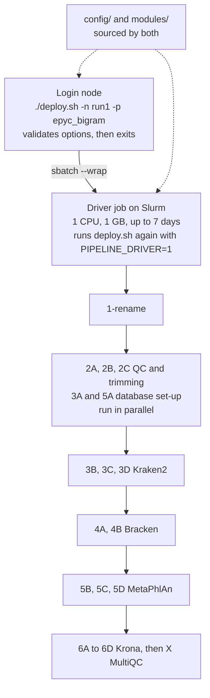
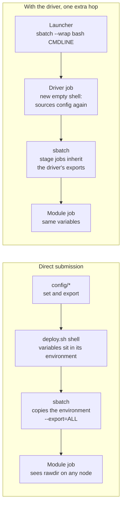
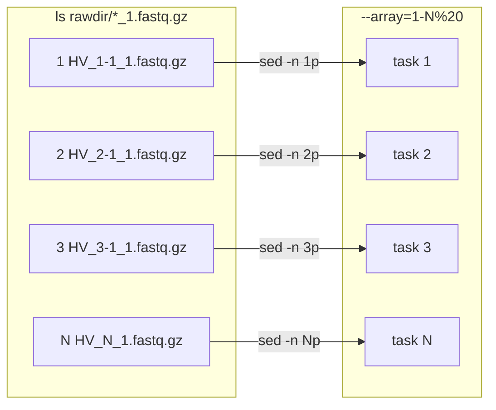
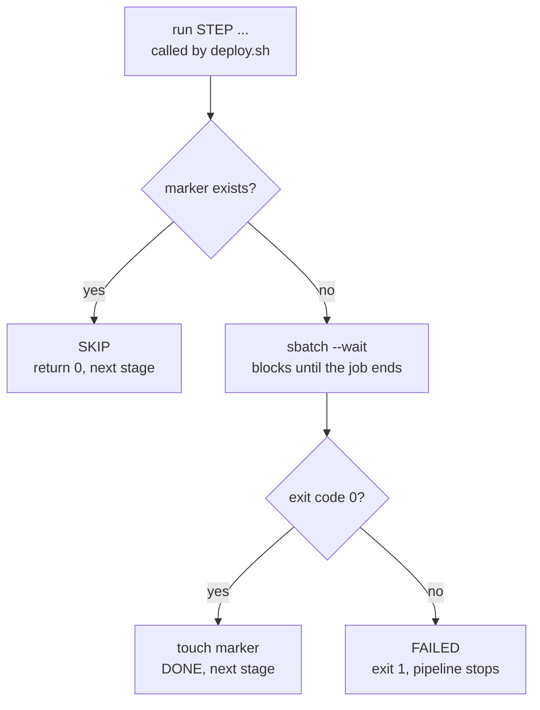
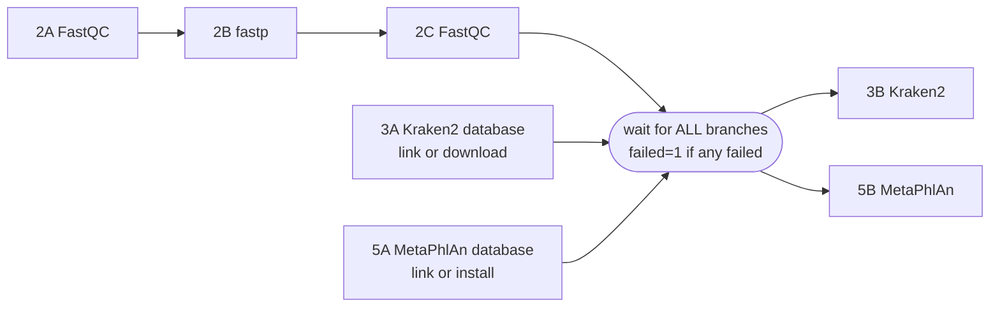
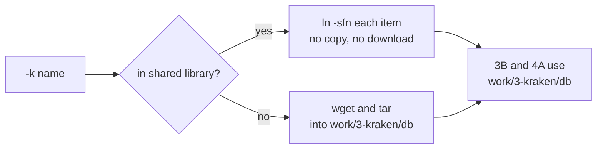

# How the pipeline works: a guide to its design

This guide explains the structure of `metagenomic_slurm` and the bash and Slurm features it relies on. For the general principles behind the design, so you can build a new pipeline on the same pattern, see the [Slurm pipeline guide](https://github.com/Peter-Kille/slurm_pipeline_guide).

> A version with the diagrams drawn as standalone graphics is in [`guide.html`](guide.html). Download it and open it in a browser; GitHub shows HTML files as source.

**Contents**

1. [The big picture](#1-the-big-picture)
2. [Repository layout](#2-repository-layout)
3. [The config layer: options and variables](#3-the-config-layer-options-and-variables)
4. [How variables reach the jobs](#4-how-variables-reach-the-jobs)
5. [Anatomy of a module script](#5-anatomy-of-a-module-script)
6. [Array jobs: one task per sample](#6-array-jobs-one-task-per-sample)
7. [The driver job](#7-the-driver-job)
8. [The run() function and done markers](#8-the-run-function-and-done-markers)
9. [Running stages in parallel, then gating](#9-running-stages-in-parallel-then-gating)
10. [Shared databases: link, don't copy](#10-shared-databases-link-dont-copy)
11. [Recording the command line](#11-recording-the-command-line)
12. [Monitoring, cancelling, resuming](#12-monitoring-cancelling-resuming)
13. [Pitfalls checklist](#13-pitfalls-checklist)

---

## 1. The big picture

The pipeline has three layers, each doing one job:

- **`config/`** reads the command-line options, sets defaults, creates folders and exports variables.
- **`modules/`** holds one script per analysis stage. A module knows only how to do its own step.
- **`deploy.sh`** sources the config, then runs the modules in order, one stage at a time.

When you run `./deploy.sh` it does not run the pipeline itself. It validates your options, then submits *itself* as a small Slurm job (the *driver*). The driver submits each stage, waits for it, and only then moves on, so nothing has to stay alive on the login node.



*Figure 1. Launcher, driver job and stages. Each stage is one `sbatch --wait`; on success a marker `.done_STAGE` is written, and on a rerun finished stages are skipped.*

## 2. Repository layout

```text
metagenomic_slurm/
├── deploy.sh              # launcher + driver: defines run(), lists the stages in order
├── config/
│   ├── arguments          # getopt options, defaults, validation, exports
│   ├── folders            # creates directories, exports their paths, logs the command
│   └── programs           # module names (e.g. metaphlan_module), checked on the login node
├── modules/
│   ├── 1-rename.sh        # one script per stage; array stages end in _array.sh
│   ├── 2A-fastqc_array.sh
│   ├── ...
│   └── scripts/           # helper scripts (python, R) called by modules
├── README.md
└── work/ outdir/ raw_data/   # created at run time
```

The naming convention matters: the file name without `.sh` becomes the stage's label for logs and done markers (`.done_2B-fastp_array`). Prefixes such as `2A`, `2B` make the run order obvious in a directory listing.

## 3. The config layer: options and variables

`config/arguments` does four things: capture the command line, set defaults, parse options with `getopt`, then validate and export.

### 3.1 Capturing the command line

```bash
CMDLINE="$(printf '%q ' "$0" "$@")"
export CMDLINE
```

`"$0"` is the script name and `"$@"` is every argument. `printf '%q'` quotes each one so the string can be replayed exactly, including arguments with spaces. This must come *before* `getopt`, because parsing rewrites the positional parameters. The driver uses it to re-run the same command (section 7).

### 3.2 Defaults first, then override

```bash
krakendb="k2_standard_08gb_20250402"
conf_levels="0.0 0.1 0.2 0.5"
driver_part="epyc_long"
foreground="no"
```

Set a sensible default for every optional setting at the top. Options then override only what the user supplies.

### 3.3 Parsing with getopt

```bash
PARSED=$(getopt -o n:p:w:k:m:c:g:D:T:Fh \
        --long name:,partition:,work:,krakendb:,metaphlandb:,confidence:,hitgroups:,driver-partition:,driver-time:,foreground,help \
        -- "$@")
eval set -- "$PARSED"

while true; do
  case "$1" in
    -n|--name)       NAME="$2"; shift 2 ;;
    -c|--confidence) conf_levels="$2"; shift 2 ;;
    -F|--foreground) foreground="yes"; shift ;;
    --) shift; break ;;
  esac
done
```

- A letter followed by `:` takes a value (`n:`); a bare letter is a switch (`F`).
- `getopt` normalises the arguments, `eval set --` loads them back, and the `case` loop reads them two at a time (`shift 2` for option plus value, `shift` for a switch).

### 3.4 Validate early, on the login node

Check required options, allowed partitions and numeric ranges before anything is submitted. A typo caught now costs nothing; caught after a three-hour job it costs a lot.

```bash
VALID_PART=("epyc" "epyc_long" "epyc_bigram" "epyc_bigram -w c1-11")
validate_partition() {
  for valid in "${VALID_PART[@]}"; do
    [[ "$1" == "$valid" ]] && return 0
  done
  return 1
}

for c in ${conf_levels}; do
  [[ "$c" =~ ^(0(\.[0-9]+)?|1(\.0+)?)$ ]] || { echo "Error: bad --confidence '$c'"; exit 1; }
done
```

> **Pinning a node** works because the partition string is passed straight to `sbatch`: `--partition=${PART}` expands to `--partition=epyc_bigram -w c1-11`, and `-w` is Slurm's node-list flag. Keep such strings on the allow-list so users can't pass arbitrary text.

### 3.5 config/folders

`config/folders` builds every directory path once, creates it if missing, and exports it, so no module ever constructs a path by hand:

```bash
krakendir="${workdir}/3-kraken"
mkdir -p "${krakendir}"
export krakendir
```

## 4. How variables reach the jobs

This is the part that most often goes wrong. A module runs in a *different process*, usually on a different node, from the script that submitted it. It only knows a variable if that variable was **exported** in the submitting shell. `sbatch` copies the submitting shell's environment into the job by default (`--export=ALL`).



*Figure 2. Exports travel from config, through `sbatch`, into every module.*

Rules that follow:

1. Export anything a module needs.
2. A module cannot change the submitter's variables; pass results through files.
3. Config is re-run on a compute node by the driver, so it must work there (only `module load` and shared paths).

### Two details that bite

- **Memory variables.** A job started with `--mem=1G` has `SLURM_MEM_PER_NODE` set in its environment. Any `sbatch` it launches inherits that and can conflict with a child's `--mem-per-cpu`. The driver therefore starts with `unset SLURM_MEM_PER_NODE SLURM_MEM_PER_CPU SLURM_MEM_PER_GPU`.
- **Modules.** `module load` only affects the current shell. Each module script loads what it needs itself (`module load ${metaphlan_module}`).

## 5. Anatomy of a module script

```bash
#!/bin/bash
#SBATCH --nodes=1
#SBATCH --tasks-per-node=1
#SBATCH --cpus-per-task=16
#SBATCH --mem=128000          # megabytes

echo "hostname=$(hostname)"
echo "SLURM_JOB_ID=${SLURM_JOB_ID}"
cat $0                         # print this script into the job log

module load ${metaphlan_module}

file=$(ls "${rawdir}"/*_1.fastq.gz | sed -n ${SLURM_ARRAY_TASK_ID}p)
R1=$(basename $file | cut -f1 -d.)
base=$(echo $R1 | sed 's/_1$//')

metaphlan ${trimdir}/${base}_trim_1.fastq.gz,${trimdir}/${base}_trim_2.fastq.gz \
    --nproc ${SLURM_CPUS_PER_TASK} -o ${metaphlandir}/${base}.metagenome.txt
```

| Element | What it does |
|---|---|
| `#SBATCH ...` | Resources for *this* stage. Slurm reads these as comments, so the resources live with the code that needs them. Options passed on the `sbatch` command line (partition, job name, log paths) override or add to them. |
| `cat $0` | Writes the exact script into the job's log, so every log records the code that produced it. |
| `${SLURM_CPUS_PER_TASK}` | Pass this to the tool's thread option, so the script and the resource request can never disagree. |
| `${rawdir}`, `${trimdir}` | Exported by config; never hard-code paths in modules. |
| `${SLURM_ARRAY_TASK_ID}` | Which sample this task handles (next section). |

## 6. Array jobs: one task per sample

Per-sample stages use a Slurm array: one submission, N tasks, each with its own `SLURM_ARRAY_TASK_ID`. The task picks its sample by position in the sorted file list:

```bash
file=$(ls "${rawdir}"/*_1.fastq.gz | sed -n ${SLURM_ARRAY_TASK_ID}p)
```

`sed -n 3p` prints only line 3, so task 3 gets the third file. The array size is set by the driver: `--array="1-${sample_number}%20"`.



*Figure 3. Array task IDs map to samples by line number. `%20` allows at most 20 tasks to run at once; the rest wait as one pending array record.*

> **Watch the limit.** Every array task counts towards the cluster's `MaxSubmitJobs`: 100 samples is about 100 submissions.

Tune the `%` limit to the stage: high for light tasks (FastQC, `%20`), low for heavy ones (Kraken2 with a memory-mapped database, `%4`) so you don't saturate a node or the shared file system.

## 7. The driver job

### The problem it solves

The first version submitted every stage upfront, chained with `-d singleton`. That put dozens of jobs (plus every array task) in the queue at once, which hit the scheduler's limit on submitted jobs.

| | Upfront submission (`-d singleton`) | Driver, one stage at a time |
|---|---|---|
| Jobs in the queue | About 20 stages, all pending from the start | The driver plus the current stage |
| Counted against `MaxSubmitJobs` | Everything, immediately | Only the current stage's tasks |
| After a failure | Hard to resume | Driver stops at that stage; markers let a rerun carry on |

### Handing over to the driver

Near the top of `deploy.sh`, a launcher block submits the script to itself and exits:

```bash
if [[ -z "${PIPELINE_DRIVER}" && "${foreground}" != "yes" ]]; then
    driver_id=$(sbatch --parsable \
        --job-name="${NAME}_driver" --partition=${driver_part} \
        --time="${driver_time}" --nodes=1 --ntasks=1 --cpus-per-task=1 --mem=1G \
        --output="${log}/0_driver_%J.out" --error="${log}/0_driver_%J.err" \
        --export=ALL,PIPELINE_DRIVER=1 \
        --wrap "cd '$(pwd -P)' && bash ${CMDLINE}")
    echo "Driver job submitted: ${driver_id}"
    exit 0
fi
```

| Piece | Meaning |
|---|---|
| `[[ -z "${PIPELINE_DRIVER}" ]]` | True only when the flag is not set: this is the launcher. Inside the driver the flag is set, so the block is skipped and the stage list runs. This single variable lets one file play both roles. |
| `--parsable` | Makes `sbatch` print just the job ID, which `$(...)` captures. |
| `--export=ALL,PIPELINE_DRIVER=1` | Passes the whole environment *and* adds the flag. |
| `--wrap "..."` | Wraps a one-line command into a throwaway job script, so there is no separate file. |
| `cd '$(pwd -P)'` | Expanded now, on the login node, into the absolute launch directory, so the driver starts in the same place (the relative `source config/arguments` needs it). |
| `bash ${CMDLINE}` | Replays the original command line, captured in section 3.1. |
| `%J` | Slurm fills in the job ID in the log file names. |

The `-F`/`--foreground` option skips the hand-over and runs the stages in the current shell, useful inside `tmux` or for debugging.

> **Walltime.** The driver lives as long as the whole pipeline, so give it the longest-allowed partition (`epyc_long`, 7 days here). If it times out, the stage in flight keeps running, and a rerun resumes from the done markers.

## 8. The run() function and done markers

```bash
# Usage: run STEP_NAME  <sbatch options...>  <module script>
run() {
    step_name="$1"       # first argument: a label for this stage
    shift                # remove it, leaving only the sbatch arguments

    marker="${workdir}/.done_${step_name}"

    # 1. Already finished in an earlier run? Then skip it.
    if [ -e "$marker" ]; then
        echo "$(date '+%F %T') SKIP   ${step_name} (done marker found)"
        return 0
    fi

    # 2. Submit the job and wait until it finishes.
    echo "$(date '+%F %T') SUBMIT ${step_name}"
    sbatch --wait "$@"
    exit_code=$?

    # 3. Success: leave a marker. Failure: stop everything.
    if [ "$exit_code" -eq 0 ]; then
        touch "$marker"
        echo "$(date '+%F %T') DONE   ${step_name}"
    else
        echo "$(date '+%F %T') FAILED ${step_name} - stopping the pipeline" >&2
        exit 1
    fi
}
```



*Figure 4. The three outcomes of `run()`: skip, done, failed.*

### Why `sbatch --wait` works

- It blocks until the job ends, then exits with the job's status. Zero means success; non-zero means failure.
- For an array it waits for *all* tasks and is non-zero if any task failed.
- It therefore replaces dependency flags: the driver itself enforces the order.

### Resuming

The markers live in `${workdir}` as empty files. Fix the problem, run the same `deploy.sh` command again, and finished stages print `SKIP`. To force a stage to rerun, delete its marker and the markers of every stage after it:

```bash
rm work/.done_3B-kraken_array work/.done_3C-kraken_merge ...
```

> A marker records "Slurm reported success", not "the output is right". If you change a stage's code or inputs, remove its marker too.

## 9. Running stages in parallel, then gating

Quality control and the database downloads don't depend on each other, so they run side by side. The expensive searches (Kraken2, MetaPhlAn) must wait for all of them. Bash does this with background subshells and `wait`:

```bash
prep_pids=()

( run 2A-fastqc_array ... ; run 2B-fastp_array ... ; run 2C-fastqc-trim ... ) &
prep_pids+=($!)

run 3A-krakendownload ... &
prep_pids+=($!)

run 5A-metaphlandb_download ... &
prep_pids+=($!)

prep_failed=0
for pid in "${prep_pids[@]}"; do
    wait "$pid" || prep_failed=1
done
[[ "$prep_failed" -ne 0 ]] && { echo "prep failed - not starting searches" >&2; exit 1; }
```



*Figure 5. Parallel preparation, then a barrier. Any failing branch stops the searches; branches that finished keep their markers.*

- `( ... ) &` runs a group of commands as one background job; `$!` is its process ID.
- `exit 1` inside `run` only ends that background branch. The `wait ... || failed=1` loop is what notices and stops the whole pipeline.
- Every branch needs a `wait`: an unwaited background job would let the driver run on regardless.

## 10. Shared databases: link, don't copy

Large reference databases (Kraken2 pluspf is about 116 GB) live once in a shared library, with one sub-folder per version named exactly as the `-k` and `-m` options:

```text
/mnt/ecotox/GROUP-smbpk/resources/
├── kraken/
│   └── k2_pluspf_20250402/      # hash.k2d, opts.k2d, taxo.k2d, ...
└── metaphlan/
    └── mpa_vJan25_CHOCOPhlAnSGB_202503/
```

The library location is the `resources_dir` variable in `config/arguments`. Steps 3A and 5A check that folder first and link if it's present, otherwise download:

```bash
shared_db="${resources_dir}/kraken/${krakendb}"

if [[ -s "${shared_db}/hash.k2d" && -s "${shared_db}/opts.k2d" && -s "${shared_db}/taxo.k2d" ]]; then
    for item in "${shared_db}"/*; do
        ln -sfn "${item}" "${krakendbdir}/$(basename "${item}")"
    done
else
    wget -P ${krakendbdir}/ https://genome-idx.s3.amazonaws.com/kraken/${krakendb}.tar.gz
    tar -xvzf ${krakendbdir}/${krakendb}.tar.gz -C ${krakendbdir}/
    rm ${krakendbdir}/${krakendb}.tar.gz
fi
```



*Figure 6. The same work folder results either way, so later stages need no changes.*

| Choice | Why |
|---|---|
| Symlink, not copy | No extra 100 GB per run, instant, and concurrent jobs on one node share the same page cache when memory-mapped. Keep the library read-only. |
| Link each item (loop), not the folder | The work folder stays an ordinary directory, and re-running is safe: `ln -sfn` replaces an existing link instead of creating one inside the target. |
| `-s` checks on key files | Tests that the file exists and is non-empty, so a half-created folder doesn't count as "found". |
| Trade-off | On a network mount, the first read of a memory-mapped database is slower while the cache fills. If that hurts, copy to node-local scratch instead. |

## 11. Recording the command line

Each launch appends to `work/0-log/0_execution_commandline.txt`, so the log shows exactly how a result was produced:

```bash
if [[ -z "${PIPELINE_DRIVER}" ]]; then {
    echo "# $(date '+%Y-%m-%d %H:%M:%S') user=${USER} host=$(hostname)"
    echo "# cwd: $(pwd -P)"
    echo "${CMDLINE}"
    echo ""
} >> "${log}/0_execution_commandline.txt"; fi
```

It is skipped inside the driver (which replays the same command) so each launch is logged once. `>>` appends, so repeated deploys build a history. Together with the module logs (which contain each script via `cat $0`) you have the full recipe for every run.

## 12. Monitoring, cancelling, resuming

| Task | Command |
|---|---|
| Start a run | `./deploy.sh -n run1 -p epyc_bigram` |
| Follow progress | `tail -f work/0-log/0_driver_<jobid>.out` (lines read SUBMIT / DONE / SKIP / FAILED) |
| Check errors from the driver | `cat work/0-log/0_driver_<jobid>.err` |
| See what is queued | `squeue -u $USER` or `squeue -u $USER -n run1` |
| Look at a stage's logs | `work/0-log/<stage>_<jobid>.out` and `.err` |
| Cancel everything | `scancel <driver_id>`, then `scancel -u $USER -n run1` for the running stage |
| Why did a job die? | `sacct -j <jobid> --format=JobID,State,ExitCode,MaxRSS,Elapsed` |
| Resume after a failure | Fix the cause, then run the same `deploy.sh` command again |
| Force a stage to rerun | Delete its `work/.done_<stage>` (and later stages' markers) |

Cancelling the driver does *not* stop the stage it submitted. Cancel that too, or let it finish and the next run will skip it if it completed.

## 13. Pitfalls checklist

- **Windows line endings.** A script saved with CRLF breaks bash loops (`do\r`) and corrupts URLs. Keep shell scripts LF; the repository's `.gitattributes` helps.
- **Un-exported variables.** If a module reports an empty path, the variable was set but not exported.
- **Run name uniqueness.** Done markers live in `${workdir}`; use a new `-w` or `-n` for a fresh run, or you'll skip stages you meant to repeat.
- **Race on shared state.** Count samples only *after* the stage that creates them has finished (`run` waits, so this is safe in the driver).
- **Parallel array tasks and installs.** Never install or write shared files inside an array task: all tasks run at once. Do it once in a separate non-array stage (the MetaPhlAn index in 5A).
- **Tools that refuse to overwrite.** Some (MetaPhlAn `--mapout`) fail if the output exists. Add `rm -f` before the command so reruns work.
- **Hidden defaults.** Read option names carefully: in Bracken, `-t` is a minimum-read threshold, not threads.
- **Queue limits.** Check `MaxSubmitJobs` for your QOS. Arrays count per task, so very large sample sets may need submission in chunks.
- **Time limits.** Stages with no `#SBATCH --time` get the partition default, which may be too short for slow steps.
